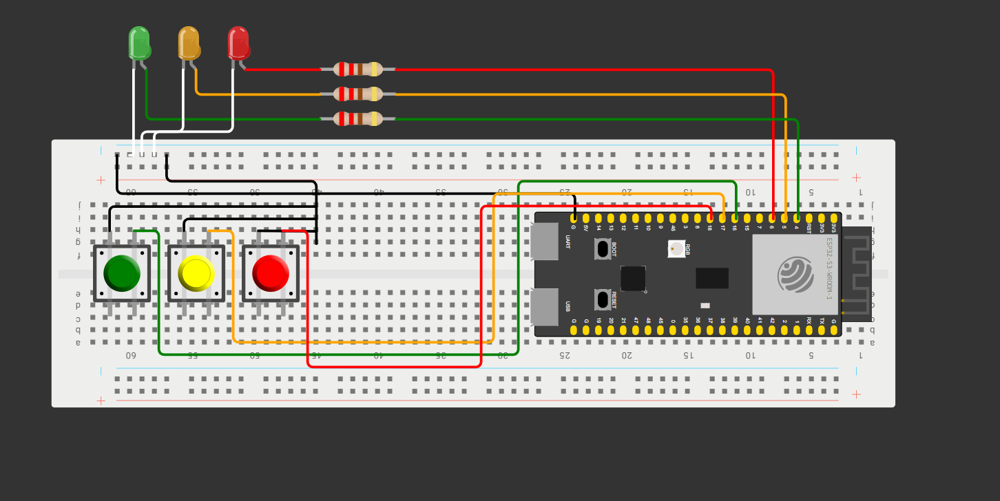
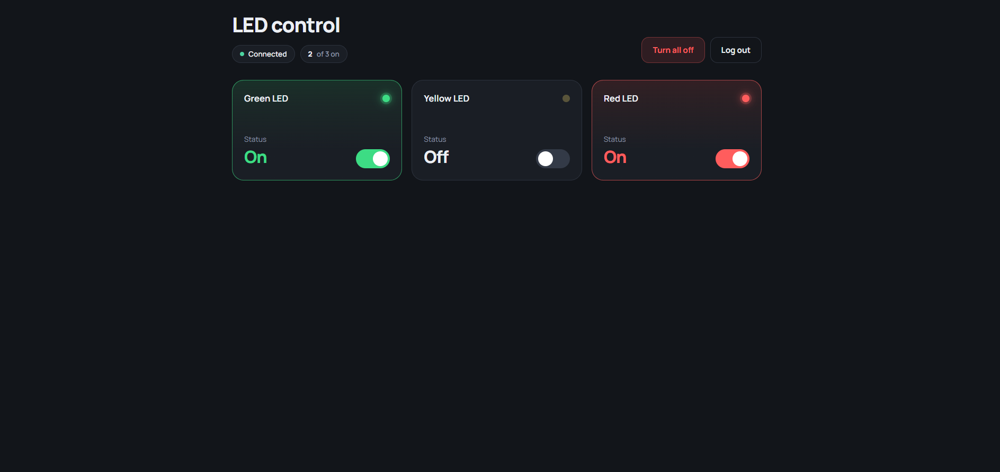
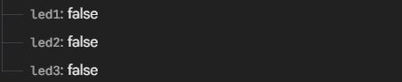

# ESP32 LED Control

A small IoT project that lets you control three LEDs connected to an ESP32 from anywhere — using either physical push buttons on the board or a web dashboard backed by Firebase Realtime Database. Changes made from the web are instantly reflected on the hardware, and vice versa.

## ⚡ TL;DR

Wire three LEDs and three push buttons to an ESP32. The ESP32 connects to Firebase and keeps `/led1`, `/led2`, and `/led3` in sync with the physical state of each LED. A simple web dashboard, also connected to Firebase, lets you toggle the same LEDs remotely from any browser.

---

## ✨ Key Features

- Toggle three LEDs (green, yellow, red) independently via physical push buttons
- Toggle the same LEDs remotely from a web dashboard
- Bidirectional sync: hardware → Firebase → web, and web → Firebase → hardware
- Firebase Authentication — the web dashboard requires a login before exposing any controls
- Real-time connection indicator and "X of 3 on" counter in the dashboard
- "Turn all off" button to shut down all LEDs at once
- Switch debouncing implemented in firmware

---

## 🔄 How It Works

```
Physical switch press
    → ESP32 reads GPIO
    → Updates Firebase RTDB (/led1 | /led2 | /led3)
    → Web dashboard reflects change in real time

Web dashboard toggle
    → Writes to Firebase RTDB (/led1 | /led2 | /led3)
    → ESP32 polls Firebase every 100 ms
    → Drives the corresponding GPIO HIGH or LOW
```

On startup the ESP32 reads the current values from Firebase and restores the LED states before entering the main loop.

---

## 🔧 Hardware

| Component | Purpose |
|-----------|---------|
| ESP32 | Main microcontroller — Wi-Fi, Firebase client, GPIO control |
| Green LED | Controlled output mapped to `/led1` |
| Yellow LED | Controlled output mapped to `/led2` |
| Red LED | Controlled output mapped to `/led3` |
| Push button × 3 | Physical on/off switches for each LED |

---

## 🔌 Wiring

| Component | ESP32 GPIO |
|-----------|-----------|
| Green LED | GPIO 4 |
| Yellow LED | GPIO 5 |
| Red LED | GPIO 6 |
| Switch (green) | GPIO 16 |
| Switch (yellow) | GPIO 17 |
| Switch (red) | GPIO 18 |

> The switches use the internal pull-up (`INPUT_PULLUP`). A pressed switch pulls the pin LOW.

---

## 🖥️ Project Images

### Wiring & Hardware



### Web Dashboard — Login


### Web Dashboard — LED Control



### Firebase Realtime Database



---

## 🛠️ Software / Tech Stack

| Layer | Technology |
|-------|-----------|
| Firmware | C/C++ (Arduino framework) |
| IDE | Arduino IDE |
| Firebase client (ESP32) | Firebase ESP Client library |
| Web dashboard | Vanilla HTML / CSS / JavaScript |
| Firebase SDK (web) | Firebase JS SDK v9.6.10 (compat) |
| Authentication | Firebase Authentication (email & password) |
| Database | Firebase Realtime Database |

---

## 🗄️ Firebase Data Structure

The project uses a flat structure at the root of the Realtime Database:

```
/
├── led1   (boolean) — true = green LED ON, false = OFF
├── led2   (boolean) — true = yellow LED ON, false = OFF
└── led3   (boolean) — true = red LED ON, false = OFF
```

Both the ESP32 firmware and the web dashboard read and write these three paths. Access is protected by Firebase Authentication.

---

## 🚀 Getting Started

### Firmware

1. Install [Arduino IDE](https://www.arduino.cc/en/software)
2. Add the ESP32 board package (URL: `https://raw.githubusercontent.com/espressif/arduino-esp32/gh-pages/package_esp32_index.json`)
3. Install the **Firebase ESP Client** library by Mobizt via the Library Manager
4. Open `src/code/code.ino` in Arduino IDE
5. Replace the Wi-Fi and Firebase credentials with your own:

```cpp
const char* ssid     = "YOUR_WIFI_SSID";
const char* password = "YOUR_WIFI_PASSWORD";

#define API_KEY       "YOUR_FIREBASE_API_KEY"
#define DATABASE_URL  "YOUR_DATABASE_URL"
#define USER_EMAIL    "YOUR_FIREBASE_AUTH_EMAIL"
#define USER_PASSWORD "YOUR_FIREBASE_AUTH_PASSWORD"
```

6. Connect the ESP32 via USB, select the correct board and port, then upload
7. Open the Serial Monitor at **115200 baud** to observe Wi-Fi connection and Firebase sync messages

### Web Dashboard

1. Open `src/index.html` in any browser (no build step required)
2. Replace the `firebaseConfig` object inside the `<script>` block with your own Firebase project credentials:

```js
const firebaseConfig = {
  apiKey:            "YOUR_API_KEY",
  authDomain:        "YOUR_PROJECT.firebaseapp.com",
  databaseURL:       "https://YOUR_PROJECT-default-rtdb.firebaseio.com",
  projectId:         "YOUR_PROJECT_ID",
  storageBucket:     "YOUR_PROJECT.appspot.com",
  messagingSenderId: "YOUR_SENDER_ID",
  appId:             "YOUR_APP_ID"
};
```

3. Sign in with the Firebase Authentication email and password you configured
4. Use the toggle switches to control the LEDs remotely

---

## 📚 What I Learned

- Configuring GPIO inputs (with `INPUT_PULLUP`) and outputs on an ESP32
- Implementing software debouncing for physical buttons
- Authenticating an ESP32 with Firebase using email/password
- Reading from and writing to Firebase Realtime Database from firmware
- Building a bidirectional sync between physical hardware and a cloud database
- Consuming Firebase Realtime Database from a plain HTML/JS web page using the compat SDK
- Protecting a web dashboard with Firebase Authentication

---

## 🔮 Future Improvements

- Replace polling with Firebase streaming (event-driven) to reduce latency and network usage
- Add individual LED scheduling (turn on/off at a set time)
- Migrate the web dashboard to use the modular Firebase SDK (v9+)
