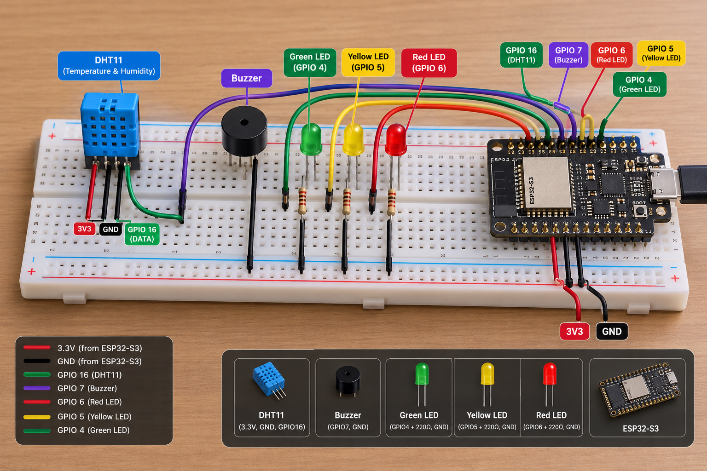
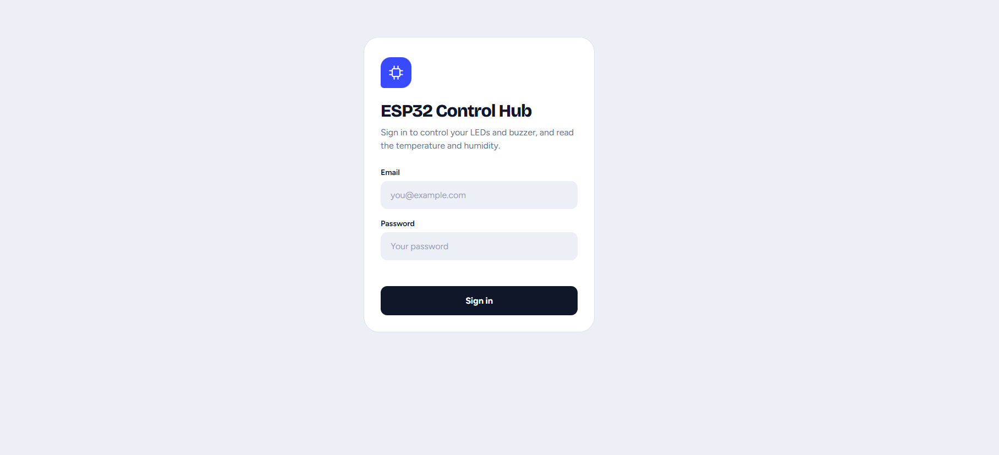
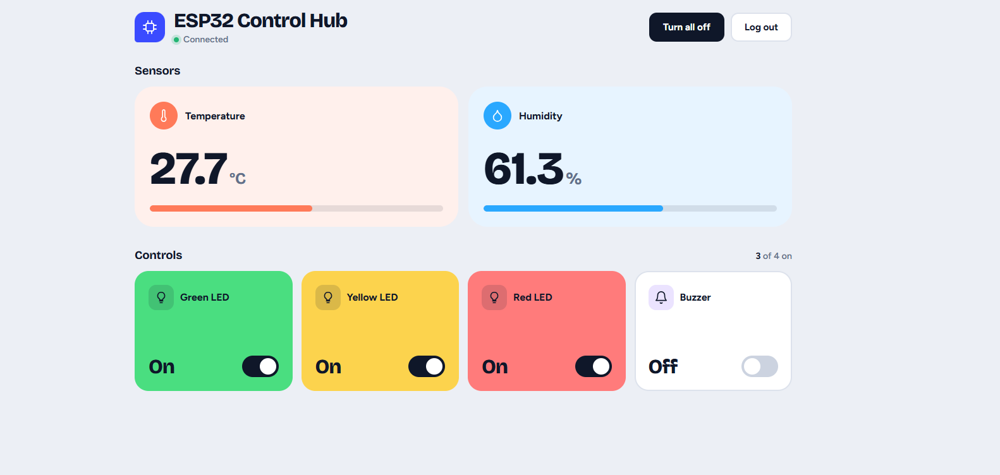
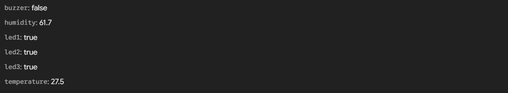

# ESP32 Control Hub

A multi-task IoT project built around an ESP32 that combines remote LED and buzzer control with live temperature and humidity monitoring — all managed through Firebase Realtime Database and a single-page web dashboard.

## ⚡ TL;DR

The ESP32 reads a DHT11 sensor every two seconds and pushes temperature and humidity to Firebase. It also listens for changes on four control paths (`/led1`, `/led2`, `/led3`, `/buzzer`) and drives the corresponding outputs accordingly. A web dashboard lets you view the live sensor readings and toggle each output remotely, all behind a Firebase Authentication login.

---

## ✨ Key Features

- Remote control of three LEDs (green, yellow, red) and a buzzer from a web dashboard
- Live temperature and humidity readings from a DHT11 sensor displayed in the dashboard
- Real-time bidirectional sync between ESP32 and Firebase Realtime Database
- Firebase Authentication — the dashboard requires login before any data is accessible
- Visual progress bars for temperature and humidity in the web UI
- "Turn all off" button to reset all four outputs at once
- Animated buzzer icon in the dashboard while the buzzer is active

---

## 🔄 How It Works

```
DHT11 sensor
    → ESP32 reads temperature & humidity every 2 seconds
    → Pushes new values to Firebase (/temperature, /humidity)
    → Web dashboard displays live readings with progress bars

Web dashboard toggle
    → Writes true/false to Firebase (/led1 | /led2 | /led3 | /buzzer)
    → ESP32 polls Firebase in main loop
    → Drives the corresponding GPIO HIGH or LOW
```

On startup the ESP32 reads the current values of all four control paths from Firebase and restores the output states before entering the main loop.

---

## 🔧 Hardware

| Component | Purpose |
|-----------|---------|
| ESP32 | Main microcontroller — Wi-Fi, Firebase client, GPIO control |
| DHT11 | Temperature and humidity sensor |
| Green LED | Controlled output mapped to `/led1` |
| Yellow LED | Controlled output mapped to `/led2` |
| Red LED | Controlled output mapped to `/led3` |
| Buzzer | Controlled output mapped to `/buzzer` |

---

## 🔌 Wiring

| Component | ESP32 GPIO |
|-----------|-----------|
| Green LED | GPIO 4 |
| Yellow LED | GPIO 5 |
| Red LED | GPIO 6 |
| Buzzer | GPIO 7 |
| DHT11 Data | GPIO 16 |

---

## 🖥️ Project Images

### Wiring & Components



### Web Dashboard — Login



### Web Dashboard — Control Hub



### Firebase Realtime Database



---

## 🛠️ Software / Tech Stack

| Layer | Technology |
|-------|-----------|
| Firmware | C/C++ (Arduino framework) |
| IDE | Arduino IDE |
| Sensor library | DHT sensor library |
| Firebase client (ESP32) | Firebase ESP Client library |
| Web dashboard | Vanilla HTML / CSS / JavaScript |
| Firebase SDK (web) | Firebase JS SDK v9.6.10 (compat) |
| Authentication | Firebase Authentication (email & password) |
| Database | Firebase Realtime Database |

---

## 🗄️ Firebase Data Structure

The project uses a flat structure at the root of the Realtime Database:

```
/
├── led1         (boolean) — true = green LED ON, false = OFF
├── led2         (boolean) — true = yellow LED ON, false = OFF
├── led3         (boolean) — true = red LED ON, false = OFF
├── buzzer       (boolean) — true = buzzer ON, false = OFF
├── temperature  (float)   — current temperature in °C from DHT11
└── humidity     (float)   — current relative humidity in % from DHT11
```

The ESP32 writes to `/temperature` and `/humidity` and reads from the four boolean paths. The web dashboard reads sensor values and reads/writes the four control paths. Access is protected by Firebase Authentication.

---

## 🚀 Getting Started

### Firmware

1. Install [Arduino IDE](https://www.arduino.cc/en/software)
2. Add the ESP32 board package (URL: `https://raw.githubusercontent.com/espressif/arduino-esp32/gh-pages/package_esp32_index.json`)
3. Install the following libraries via the Library Manager:
   - **Firebase ESP Client** by Mobizt
   - **DHT sensor library** by Adafruit (also install **Adafruit Unified Sensor** if prompted)
4. Open `src/code/code.ino` in Arduino IDE
5. Replace the Wi-Fi and Firebase credentials with your own:

```cpp
const char* ssid     = "YOUR_WIFI_SSID";
const char* password = "YOUR_WIFI_PASSWORD";

#define API_KEY       "YOUR_FIREBASE_API_KEY"
#define DATABASE_URL  "YOUR_DATABASE_URL"
#define USER_EMAIL    "YOUR_FIREBASE_AUTH_EMAIL"
#define USER_PASSWORD "YOUR_FIREBASE_AUTH_PASSWORD"
```

6. Connect the ESP32 via USB, select the correct board and port, then upload
7. Open the Serial Monitor at **115200 baud** — you should see Wi-Fi connection status, initial Firebase reads, and periodic sensor values

### Web Dashboard

1. Open `src/index.html` in any browser (no build step required)
2. Replace the `firebaseConfig` object inside the `<script>` block with your own Firebase project credentials:

```js
const firebaseConfig = {
  apiKey:            "YOUR_API_KEY",
  authDomain:        "YOUR_PROJECT.firebaseapp.com",
  databaseURL:       "https://YOUR_PROJECT-default-rtdb.firebaseio.com",
  projectId:         "YOUR_PROJECT_ID",
  storageBucket:     "YOUR_PROJECT.appspot.com",
  messagingSenderId: "YOUR_SENDER_ID",
  appId:             "YOUR_APP_ID"
};
```

3. Sign in with the Firebase Authentication email and password you configured
4. The Sensors section shows live temperature (°C) and humidity (%) with progress bars
5. Use the toggle switches in the Controls section to operate each LED and the buzzer remotely

---

## 📚 What I Learned

- Reading temperature and humidity from a DHT11 sensor using the Arduino DHT library
- Conditionally writing sensor data to Firebase only when the value changes (avoiding unnecessary writes)
- Controlling multiple output types (LEDs and buzzer) from the same Firebase-connected firmware
- Building a web dashboard that shows read-only sensor data alongside interactive controls
- Structuring Firebase Realtime Database paths to separate sensor readings from control commands
- Using Firebase Authentication to secure both firmware and web access with the same credentials

---

## 🔮 Future Improvements

- Add temperature/humidity history with a simple chart in the web dashboard
- Implement threshold-based alerts (e.g., buzzer activates automatically when temperature exceeds a limit)
- Replace polling with Firebase streaming for lower-latency control response
