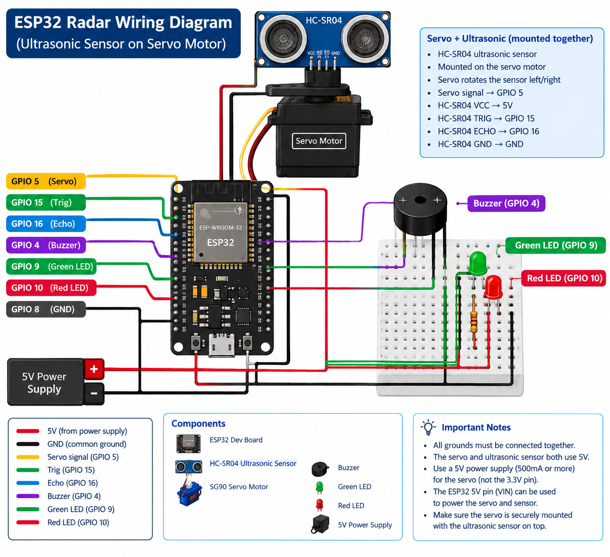
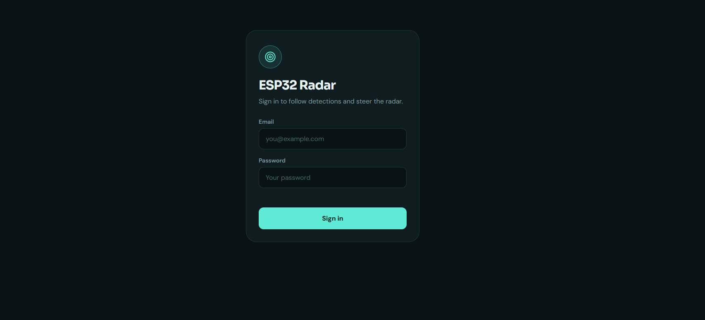
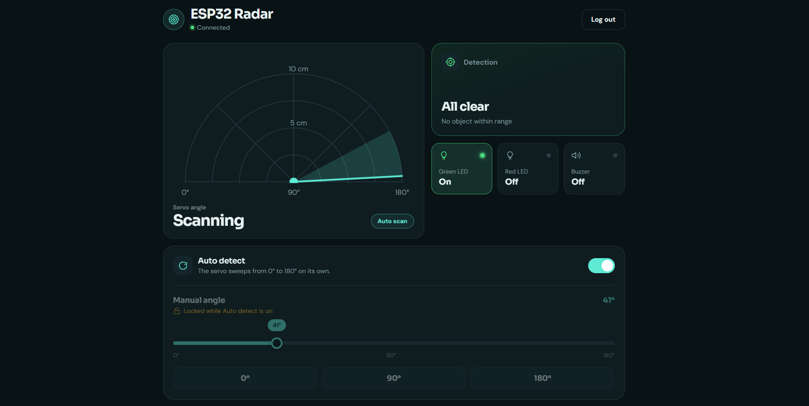
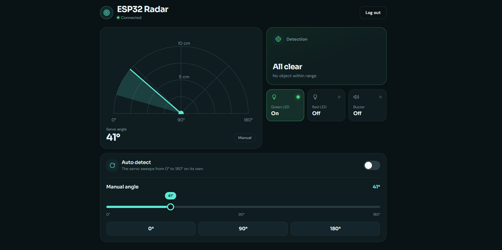
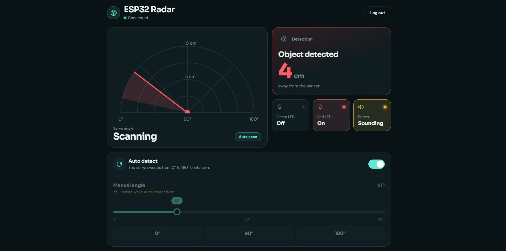
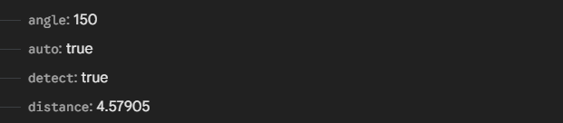

# ESP32 Radar

A real-time IoT radar project built around an ESP32, a servo motor, and an HC-SR04 ultrasonic sensor. The servo sweeps 0°–180° scanning for nearby objects. Detection state, distance, and servo angle are pushed to Firebase Realtime Database and visualised on an animated web dashboard — all behind a Firebase Authentication login.

## ⚡ TL;DR

The ESP32 drives a servo motor that continuously sweeps or locks to a specific angle. An HC-SR04 ultrasonic sensor measures distance at each position. When an object is detected within 10 cm, a buzzer sounds and a red LED lights up; otherwise the green LED stays on. A web dashboard shows a live animated radar sweep, the current servo angle, the detection state, and distance — and lets you toggle between Auto and Manual mode or set a precise angle remotely.

---

## ✨ Key Features

- Animated radar sweep visualization in the browser using inline SVG
- Two operating modes: **Auto** (servo sweeps 0°→180°→0° autonomously) and **Manual** (angle controlled from the dashboard)
- Live detection state and distance readout pushed to Firebase in real time
- Object proximity alarm: buzzer + red LED activate when an object is within 10 cm
- Angle slider and 0°/90°/180° preset buttons for quick manual positioning
- Connection indicator and mode badge in the dashboard
- Firebase Authentication — the dashboard requires login before any controls or data are accessible

---

## 🔄 How It Works

```
Auto mode
    → ESP32 sweeps servo 0°→180°→0° (2° steps, 8 ms delay)
    → HC-SR04 measures distance at every position
    → If object < 10 cm: buzzer ON, red LED ON, green LED OFF
    → Pushes /detect (bool) and /distance (float) to Firebase every 500 ms
    → Web dashboard animates the needle and shows detection state

Manual mode
    → Web dashboard writes target angle to Firebase (/angle)
    → ESP32 polls /angle every 100 ms and moves servo to match
    → HC-SR04 still measures distance; detection logic still runs
    → Dashboard shows a blip at the object's position on the radar

Mode switching
    → Web dashboard writes true/false to Firebase (/auto)
    → ESP32 polls /auto and transitions between modes accordingly
```

---

## 🔧 Hardware

| Component | Purpose |
|-----------|---------|
| ESP32 | Main microcontroller — Wi-Fi, Firebase client, servo & GPIO control |
| Servo motor | Rotates the sensor from 0° to 180° |
| HC-SR04 | Ultrasonic distance sensor (trigger + echo) |
| Green LED | ON when no object is detected |
| Red LED | ON when an object is detected within range |
| Buzzer | Sounds when an object is detected within range |

---

## 🔌 Wiring

| Component | ESP32 GPIO |
|-----------|-----------|
| Servo signal | GPIO 5 |
| HC-SR04 Trig | GPIO 15 |
| HC-SR04 Echo | GPIO 16 |
| Green LED | GPIO 9 |
| Red LED | GPIO 10 |
| Buzzer | GPIO 4 |
| HC-SR04 GND (via pin) | GPIO 8 (driven LOW as shared GND) |

> The servo is powered from the 5 V pin of the ESP32 dev board. The HC-SR04 VCC connects to 3.3 V or 5 V depending on your module variant.

---

## 🖥️ Project Images

### Wiring & Hardware



### Web Dashboard — Login



### Web Dashboard — Auto Detect Mode



### Web Dashboard — Manual Detect Mode



### Web Dashboard — Object Detected



### Firebase Realtime Database



---

## 🛠️ Software / Tech Stack

| Layer | Technology |
|-------|-----------|
| Firmware | C/C++ (Arduino framework) |
| IDE | Arduino IDE |
| Servo library | ESP32Servo |
| Firebase client (ESP32) | Firebase ESP Client library |
| Web dashboard | Vanilla HTML / CSS / JavaScript |
| Firebase SDK (web) | Firebase JS SDK v9.6.10 (compat) |
| Authentication | Firebase Authentication (email & password) |
| Database | Firebase Realtime Database |

---

## 🗄️ Firebase Data Structure

The project uses a flat structure at the root of the Realtime Database:

```
/
├── auto      (boolean) — true = auto scan mode, false = manual mode
├── angle     (integer) — servo target angle in degrees (0–180), used in manual mode
├── detect    (boolean) — true = object within 10 cm detected, false = clear
└── distance  (float)   — measured distance in cm (updated every 500 ms when detect is true)
```

The ESP32 reads `/auto` and `/angle` (in manual mode) and writes `/detect` and `/distance`. The web dashboard reads all four paths and writes `/auto` and `/angle`. Access is protected by Firebase Authentication.

---

## 🚀 Getting Started

### Firmware

1. Install [Arduino IDE](https://www.arduino.cc/en/software)
2. Add the ESP32 board package (URL: `https://raw.githubusercontent.com/espressif/arduino-esp32/gh-pages/package_esp32_index.json`)
3. Install the following libraries via the Library Manager:
   - **Firebase ESP Client** by Mobizt
   - **ESP32Servo** by Kevin Harrington
4. Open `src/code/code.ino` in Arduino IDE
5. Replace the Wi-Fi and Firebase credentials with your own:

```cpp
const char* ssid     = "YOUR_WIFI_SSID";
const char* password = "YOUR_WIFI_PASSWORD";

#define API_KEY       "YOUR_FIREBASE_API_KEY"
#define DATABASE_URL  "YOUR_DATABASE_URL"
#define USER_EMAIL    "YOUR_FIREBASE_AUTH_EMAIL"
#define USER_PASSWORD "YOUR_FIREBASE_AUTH_PASSWORD"
```

6. Connect the ESP32 via USB, select the correct board and port, then upload
7. Open the Serial Monitor at **115200 baud** — you should see Wi-Fi connection status, the initial Firebase reads, and periodic angle/distance values

### Web Dashboard

1. Open `src/index.html` in any browser (no build step required)
2. Replace the `firebaseConfig` object inside the `<script>` block with your own Firebase project credentials:

```js
const firebaseConfig = {
  apiKey:            "YOUR_API_KEY",
  authDomain:        "YOUR_PROJECT.firebaseapp.com",
  databaseURL:       "https://YOUR_PROJECT-default-rtdb.firebaseio.com",
  projectId:         "YOUR_PROJECT_ID",
  storageBucket:     "YOUR_PROJECT.appspot.com",
  messagingSenderId: "YOUR_SENDER_ID",
  appId:             "YOUR_APP_ID"
};
```

3. Sign in with the Firebase Authentication email and password you configured
4. Use the **Auto detect** toggle to start autonomous scanning, or drag the angle slider / use the preset buttons to steer the radar in manual mode

---

## 📚 What I Learned

- Controlling a servo motor from an ESP32 using the ESP32Servo library
- Measuring distance with an HC-SR04 ultrasonic sensor (trigger pulse, echo timing, speed-of-sound calculation)
- Designing a two-mode embedded system (auto-sweep vs. manual positioning) with clean state transitions
- Pushing real-time sensor data to Firebase RTDB from firmware without blocking the main loop
- Building an animated SVG radar visualization driven purely by JavaScript and Firebase listeners
- Synchronizing ESP32 firmware state and browser UI through a shared Firebase database
- Securing a hardware-connected web dashboard with Firebase Authentication

---

## 🔮 Future Improvements

- Add a full 360° radar visualization by mounting the sensor on a continuous-rotation platform
- Log detection events (timestamp, angle, distance) to Firebase for playback and analytics
- Replace polling with Firebase streaming on the ESP32 for lower-latency command delivery
- Add configurable detection threshold in the dashboard instead of the hard-coded 10 cm limit
